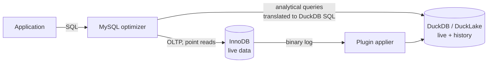
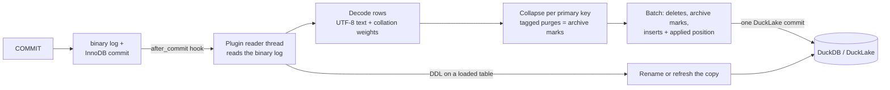
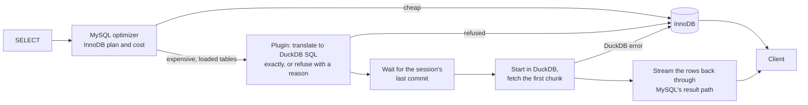

# DuckDB secondary engine for Percona Server 9.7

> **Branch `9.7-duckdb`** — Percona Server 9.7 plus a DuckDB secondary engine
> plugin under [`storage/duckdb`](/storage/duckdb). This page describes the
> plugin; the upstream Percona Server README is at [`/README.md`](/README.md).
>
> **Status: proof of concept.** Not for production use.

InnoDB stays the source of truth. A loadable plugin keeps a columnar copy of
selected tables in [DuckDB](https://duckdb.org) /
[DuckLake](https://ducklake.select), fed from the binary log, and the
optimizer sends analytical queries to it automatically. Every query that
runs in DuckDB returns exactly what InnoDB would return, or it is not sent
there.

Optionally, the DuckDB copy keeps **rows purged from InnoDB**, so the
operational tables stay small while the full history remains queryable under
the same table names.



## What makes it different

- **A plugin, not a fork of the server.** It's a loadable `ha_duckdb.so` built
  on the existing secondary engine and external executor interfaces. No server
  code changes outside `storage/duckdb`, apart from build integration (DuckDB,
  DuckLake and CRoaring as submodules, `cmake/duckdb.cmake`, one line in
  `plugin.defs`).
- **Results identical to InnoDB.** The translator either produces DuckDB SQL
  with exactly MySQL's semantics or refuses the query with a named reason, and
  the query then runs on InnoDB. MySQL semantics covered include:
  - DECIMAL arithmetic and division with `div_precision_increment`;
  - NULL ordering and unsigned ranges;
  - the session time zone for TIMESTAMP.
- **Every collation, exactly.** Columns with `_ci`, `_ai`, `general_ci` or
  non-UTF-8 collations get a hidden column holding MySQL's own weight string.
  Comparisons, GROUP BY, DISTINCT, ORDER BY and MIN/MAX use those weights, so
  `utf8mb4_0900_ai_ci` behaves as it does in InnoDB.
- **History retention.** Deletes tagged as purges (GTID tag
  `duckdb_avoid_purge`) become archive marks instead of deletes.
  `duckdb_history_scope = LIVE | FULL` (session variable or `SET_VAR` hint)
  chooses between live rows only and the full history. FULL scope requires
  the `DUCKDB_HISTORY_READER` privilege.
- **Consistent with InnoDB.** A transaction becomes visible in DuckDB only
  after its InnoDB commit. The applied position is committed in the same
  DuckLake transaction as the data. `duckdb_offload_wait_applied` gives
  read-your-own-writes.
- **Replicas.** It works on a replica of a source that doesn't have the
  plugin, including the multi-threaded applier, restarts, tagged purges and
  `super_read_only`.

## How it works

**A write** reaches the DuckDB copy through the binary log, after its
InnoDB commit:



**A query** goes to DuckDB only when it is expensive enough and every part
of it can be translated exactly; otherwise InnoDB answers:



The function-by-function version of both paths is in the
[design document](/project_duckdb/duckdb-secondary-engine-design.md#paths-through-the-code).

## Status

| Area | State |
|---|---|
| Build integration, plugin infrastructure (DWL-01, 02) | done |
| `SECONDARY_LOAD` / `UNLOAD`, detach and reattach, history copies (DWL-03) | done |
| Binlog applier: DML, large transactions, DDL follow-up, compressed payloads (DWL-04) | done |
| History retention, tagged purges, LIVE/FULL scope (DWL-05) | done |
| Query offload: expressions, joins, subqueries, derived tables, views, CTEs, UNION / INTERSECT / EXCEPT, LIKE, collations (DWL-06) | in progress |
| FULL scope guard (DWL-07) | done |
| TPC-H, 22 queries (correctness check at scale factor 0.01) | **19 offloaded with identical results**, 3 refused (Q16, Q21, Q22), none wrong — [details](/project_duckdb/tpch/README.md) |
| Tests | 25 MTR tests, each offloaded query run with offload OFF and FORCED and the results compared; 39 unit tests |

Not yet supported:
- Window functions and ROLLUP.
- JSON, spatial and VECTOR columns.
- DECIMAL above precision 38.
- Offload inside multi-statement transactions (a server rule).

The full list is in [HOWTO § 12](/project_duckdb/HOWTO.md).

## Quick start

Build (the first build compiles DuckDB and takes a while):

```bash
git clone -b 9.7-duckdb https://github.com/Tusamarco/percona-server.git
cd percona-server
git submodule update --init extra/duckdb/duckdb extra/duckdb/ducklake extra/duckdb/croaring
mkdir ../build && cd ../build
cmake ../percona-server -DCMAKE_BUILD_TYPE=RelWithDebInfo -DWITH_DUCKDB=ON
cmake --build . -j 8
```

Configure (`my.cnf`, minimum):

```ini
[mysqld]
plugin-load-add           = ha_duckdb.so
loose-duckdb_memory_limit = 4G      # mandatory
loose-duckdb_threads      = 4       # mandatory
log_bin                   = binlog
binlog_format             = ROW
binlog_row_image          = FULL
binlog_row_metadata       = FULL
gtid_mode                 = ON
enforce_gtid_consistency  = ON
sync_binlog               = 1
```

Use it:

```sql
CREATE TABLE orders (
  id BIGINT PRIMARY KEY,
  customer VARCHAR(64),
  amount DECIMAL(12,2),
  created_at DATETIME
) SECONDARY_ENGINE = duckdb
  SECONDARY_ENGINE_ATTRIBUTE = '{"retain_history": true}';

ALTER TABLE orders SECONDARY_LOAD;

-- analytical queries go to DuckDB when the cost is high enough
SET use_secondary_engine = ON;          -- FORCED: DuckDB or an error with the reason
SELECT customer, SUM(amount) FROM orders GROUP BY customer;
SHOW STATUS LIKE 'duckdb_offload%';     -- queries, refused, last refusal reason

-- purge old rows from InnoDB, keep them in DuckDB
SET gtid_next = 'AUTOMATIC:duckdb_avoid_purge';
DELETE FROM orders WHERE created_at < NOW() - INTERVAL 1 YEAR;
SET gtid_next = 'AUTOMATIC';

-- query the full history
SELECT /*+ SET_VAR(duckdb_history_scope = FULL) */ COUNT(*) FROM orders;
```

The [tutorial](/project_duckdb/TUTORIAL.md) walks through all of this step by
step. Read the replica section of the [HOWTO](/project_duckdb/HOWTO.md) before
loading tables on a replica.

## Performance

These are first measurements on a release build, 14 November 2026: 8 of 16
analytical queries offloaded and ran **54× to 574× faster** than on InnoDB.
That was before the coverage work of 16–17 November, which lifted most of the
refusals. A public comparison with the MariaDB and AliSQL DuckDB engines is
planned. Raw results are in [`project_duckdb/perf`](/project_duckdb/perf).

## Documentation

| Document | For |
|---|---|
| [Design](/project_duckdb/duckdb-secondary-engine-design.md) | Goals, architecture, decisions and risks |
| [Tutorial](/project_duckdb/TUTORIAL.md) | A first session, step by step |
| [HOWTO](/project_duckdb/HOWTO.md) | Reference: configuration, variables, status, limitations |
| [Worklogs](/project_duckdb/worklog-index.md) | DWL-01 … DWL-07, the work item by item |
| [Manual test plan](/project_duckdb/manual-test-plan.md) | Scenarios run by hand, with results |
| [MTR suite](/storage/duckdb/mysql-test/duckdb) | Automated tests |
| [TPC-H check](/project_duckdb/tpch/README.md) | Query-by-query status |

## Testing

```bash
cd build/mysql-test
./mtr --suite=/path/to/percona-server/storage/duckdb/mysql-test/duckdb --parallel=2
cd .. && ./runtime_output_directory/duckdb_apply-t
```

## License

GPL-2.0, as Percona Server. DuckDB, DuckLake and CRoaring are under their own
licenses (MIT, MIT, Apache-2.0 / MIT).

Copyright (c) 2026-present, Marco Tusa.
