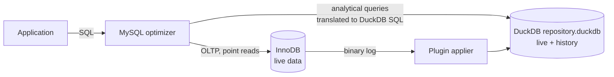
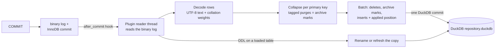
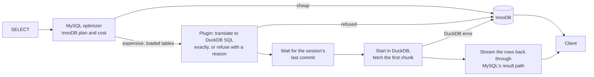

# DuckDB secondary engine for Percona Server 9.7

> **Branch `9.7-duckdb`** — Percona Server 9.7 plus a DuckDB secondary engine
> plugin under [`storage/duckdb`](/storage/duckdb). This page describes the
> plugin; the upstream Percona Server README is at [`/README.md`](/README.md).
>
> **Status: proof of concept.** Not for production use.

InnoDB stays the source of truth. A loadable plugin keeps a columnar copy of
selected tables in [DuckDB](https://duckdb.org) (one native DuckDB
database file, `repository.duckdb`), fed from the binary log, and the
optimizer sends analytical queries to it automatically. Every query that
runs in DuckDB returns exactly what InnoDB would return, or it is not sent
there.

Optionally, the DuckDB copy keeps **rows purged from InnoDB**, so the
operational tables stay small while the full history remains queryable under
the same table names.



## What makes it different

- **A plugin, not a fork of the server.** It's a loadable `ha_duckdb.so` built
  on the existing secondary engine and external executor interfaces. No server
  code changes outside `storage/duckdb`, apart from build integration (DuckDB,
  DuckLake and CRoaring as submodules, `cmake/duckdb.cmake`, one line in
  `plugin.defs`; DuckLake only migrates a lake of an earlier version).
- **Results identical to InnoDB.** The translator either produces DuckDB SQL
  with exactly MySQL's semantics or refuses the query with a named reason, and
  the query then runs on InnoDB. MySQL semantics covered include:
  - DECIMAL arithmetic and division with `div_precision_increment`;
  - NULL ordering and unsigned ranges;
  - the session time zone for TIMESTAMP.
- **Every collation, exactly.** Columns with `_ci`, `_ai`, `general_ci` or
  non-UTF-8 collations get a hidden column holding MySQL's own weight string.
  Comparisons, GROUP BY, DISTINCT, ORDER BY and MIN/MAX use those weights, so
  `utf8mb4_0900_ai_ci` behaves as it does in InnoDB.
- **History retention.** Deletes tagged as purges (GTID tag
  `duckdb_avoid_purge`) become archive marks instead of deletes.
  `duckdb_history_scope = LIVE | FULL` (session variable or `SET_VAR` hint)
  chooses between live rows only and the full history. FULL scope requires
  the `DUCKDB_HISTORY_READER` privilege.
- **Consistent with InnoDB.** A transaction becomes visible in DuckDB only
  after its InnoDB commit. The applied position is committed in the same
  DuckDB transaction as the data. `duckdb_offload_wait_applied` gives
  read-your-own-writes.
- **Replicas.** It works on a replica of a source that doesn't have the
  plugin, including the multi-threaded applier, restarts, tagged purges and
  `super_read_only`.

## How it works

**A write** reaches the DuckDB copy through the binary log, after its
InnoDB commit:



**A query** goes to DuckDB only when it is expensive enough and every part
of it can be translated exactly; otherwise InnoDB answers:



The function-by-function version of both paths is in the
[design document](/project_duckdb/duckdb-secondary-engine-design.md#paths-through-the-code).

## Status

| Area | State |
|---|---|
| Build integration, plugin infrastructure (DWL-01, 02) | done |
| `SECONDARY_LOAD` / `UNLOAD`, detach and reattach, history copies (DWL-03) | done |
| Binlog applier: DML, large transactions, DDL follow-up, compressed payloads (DWL-04) | done |
| History retention, tagged purges, LIVE/FULL scope (DWL-05) | done |
| Query offload: expressions, joins, subqueries, derived tables, views, CTEs, UNION / INTERSECT / EXCEPT, LIKE, collations, prepared statement parameters and variables, CAST / CONVERT, DATE_FORMAT, NOW() and the other clock functions (DWL-06) | in progress |
| JSON and spatial columns (loaded; the column itself, IS NULL and COUNT offloaded) | done |
| DuckDB errors at the start of execution (out of memory, temporary disk full): the query runs on InnoDB | done |
| Performance work against AliSQL and MariaDB: native DuckDB storage (`repository.duckdb`), correlated subqueries as LATERAL, NOT EXISTS / EXISTS inside OR as anti / semi joins, fewer casts, CHAR compared without rtrim | done (2026-11-25/26) — see [Performance](#performance) |
| FULL scope guard (DWL-07) | done |
| TPC-H, 22 queries (correctness check at scale factor 0.01) | **22 of 22 offloaded with identical results**, none wrong — [details](/project_duckdb/tpch/README.md); all 22 also run offloaded in HammerDB TPROC-H at scale factor 100 on a release build |
| Tests | 44 MTR tests, each offloaded query run with offload OFF and FORCED and the results compared; 42 unit tests |

Not yet supported:
- Window functions, ROLLUP, GROUP_CONCAT.
- Functions on TIMESTAMP columns when the session time zone has daylight
  saving (UTC and fixed offsets are translated).
- Functions and comparisons on JSON and spatial columns (the columns
  themselves are loaded and can be selected).
- VECTOR columns, DECIMAL columns above precision 38, tables without a
  primary key.
- Offload inside multi-statement transactions (`autocommit = 0`, `BEGIN`):
  MySQL never uses a secondary engine there.

The full list is in [HOWTO § 12](/project_duckdb/HOWTO.md).

## Quick start

Build (the first build compiles DuckDB and takes a while):

```bash
git clone -b 9.7-duckdb https://github.com/Tusamarco/percona-server.git
cd percona-server
git submodule update --init extra/duckdb/duckdb extra/duckdb/ducklake extra/duckdb/croaring
mkdir ../build && cd ../build
cmake ../percona-server -DCMAKE_BUILD_TYPE=RelWithDebInfo -DWITH_DUCKDB=ON
cmake --build . -j 8
```

Configure (`my.cnf`, minimum):

```ini
[mysqld]
plugin-load-add           = ha_duckdb.so
loose-duckdb_memory_limit = 4G      # mandatory
loose-duckdb_threads      = 4       # mandatory
log_bin                   = binlog
binlog_format             = ROW
binlog_row_image          = FULL
binlog_row_metadata       = FULL
gtid_mode                 = ON
enforce_gtid_consistency  = ON
sync_binlog               = 1
```

Use it:

```sql
CREATE TABLE orders (
  id BIGINT PRIMARY KEY,
  customer VARCHAR(64),
  amount DECIMAL(12,2),
  created_at DATETIME
) SECONDARY_ENGINE = duckdb
  SECONDARY_ENGINE_ATTRIBUTE = '{"retain_history": true}';

ALTER TABLE orders SECONDARY_LOAD;

-- analytical queries go to DuckDB when the cost is high enough
SET use_secondary_engine = ON;          -- FORCED: DuckDB or an error with the reason
SELECT customer, SUM(amount) FROM orders GROUP BY customer;
SHOW STATUS LIKE 'duckdb_offload%';     -- queries, refused, last refusal reason

-- purge old rows from InnoDB, keep them in DuckDB
SET gtid_next = 'AUTOMATIC:duckdb_avoid_purge';
DELETE FROM orders WHERE created_at < NOW() - INTERVAL 1 YEAR;
SET gtid_next = 'AUTOMATIC';

-- query the full history
SELECT /*+ SET_VAR(duckdb_history_scope = FULL) */ COUNT(*) FROM orders;
```

The [tutorial](/project_duckdb/TUTORIAL.md) walks through all of this step by
step. Read the replica section of the [HOWTO](/project_duckdb/HOWTO.md) before
loading tables on a replica.

## Performance

HammerDB TPROC-H at scale factor 100 (about 600 million LINEITEM rows),
release build, 26 November 2026. duckdb_SE is this secondary engine; the
AliSQL and MariaDB DuckDB engines ran the same HammerDB workload at the same
scale factor. Each value is the mean query time in seconds over 3 runs (per
run: the mean over its VUsers). Ratios are duckdb_SE's time divided by the
other engine's: below 1.00 duckdb_SE is faster.

Sum of the query means per number of VUsers (seconds; lower is better, the
lowest in bold; Q15 left out, see the notes), and on how many of the 21
queries duckdb_SE is the fastest of the three:

| VUsers | duckdb_SE | AliSQL | MariaDB | duckdb_SE / AliSQL | duckdb_SE / MariaDB | duckdb_SE fastest on |
|---|---|---|---|---|---|---|
| 1 | 21.3 | **20.4** | 25.3 | 1.04 | 0.84 | 12 of 21 |
| 2 | **36.2** | 38.2 | 43.1 | 0.95 | 0.84 | 13 of 21 |
| 4 | 67.9 | **67.2** | 78.7 | 1.01 | 0.86 | 10 of 21 |
| 8 | 128.9 | **125.1** | 152.2 | 1.03 | 0.85 | 5 of 21 |
| 16 | **283.8** | failed | failed | — | — | all |

Notes:
- **Pending verification of the AliSQL and MariaDB runs** (2026-11-26): with
  `mysql_raise_query_error false`, HammerDB logs a query that failed as
  completed in a few milliseconds. The AliSQL and MariaDB logs are being
  checked for errors and their runs repeated with the corrected engine
  detection; their numbers may change.
- Q15 at 0.006 s on AliSQL and MariaDB is not a real execution at this
  scale (it aggregates three months of LINEITEM twice); it is left out of
  the sums, the ratios and the fastest-engine counts.
- At 16 VUsers no AliSQL or MariaDB run completed; duckdb_SE completed
  every run.
- The three engines stop scaling at about 4 VUsers on this machine (CPU).
  At 8 VUsers duckdb_SE's times varied less between runs than the other
  two (most queries within 10%; AliSQL and MariaDB had many above 20%).
- Slower than AliSQL at 1 VUser: Q16, Q10, Q20, Q22, Q3, Q13 (next to look
  at).

Per query and number of VUsers (seconds; the fastest of the three in bold):

**1 VUser**

| Query | duckdb_SE | AliSQL | MariaDB | duckdb_SE / AliSQL | duckdb_SE / MariaDB |
|---|---|---|---|---|---|
| Q1 | **0.99** | 1.27 | 1.30 | 0.78 | 0.76 |
| Q2 | **0.25** | 0.28 | 0.31 | 0.87 | 0.81 |
| Q3 | 1.04 | **0.85** | 0.97 | 1.23 | 1.07 |
| Q4 | **0.53** | 0.75 | 0.89 | 0.71 | 0.60 |
| Q5 | **0.71** | 0.94 | 1.04 | 0.76 | 0.69 |
| Q6 | **0.18** | 0.28 | 0.29 | 0.63 | 0.61 |
| Q7 | 0.70 | **0.64** | 0.72 | 1.09 | 0.96 |
| Q8 | **0.67** | 0.72 | 0.82 | 0.93 | 0.81 |
| Q9 | 2.44 | **2.31** | 3.42 | 1.05 | 0.71 |
| Q10 | 1.65 | **0.95** | 1.07 | 1.75 | 1.55 |
| Q11 | **0.25** | 0.31 | 0.39 | 0.82 | 0.65 |
| Q12 | **0.54** | 0.73 | 0.84 | 0.75 | 0.64 |
| Q13 | 2.56 | **2.09** | 3.71 | 1.23 | 0.69 |
| Q14 | **0.57** | 0.69 | 0.79 | 0.84 | 0.73 |
| Q15 | 0.42 | 0.01 | 0.01 | — | — |
| Q16 | 1.12 | **0.53** | 0.61 | 2.13 | 1.85 |
| Q17 | **0.58** | 0.77 | 0.78 | 0.75 | 0.74 |
| Q18 | 2.32 | **2.14** | 2.29 | 1.08 | 1.01 |
| Q19 | **0.41** | 0.82 | 0.94 | 0.51 | 0.44 |
| Q20 | 1.13 | **0.71** | 0.90 | 1.58 | 1.26 |
| Q21 | **2.19** | 2.36 | 2.82 | 0.93 | 0.77 |
| Q22 | 0.43 | **0.31** | 0.35 | 1.40 | 1.22 |

**2 VUsers**

| Query | duckdb_SE | AliSQL | MariaDB | duckdb_SE / AliSQL | duckdb_SE / MariaDB |
|---|---|---|---|---|---|
| Q1 | **1.09** | 2.32 | 1.47 | 0.47 | 0.74 |
| Q2 | 1.28 | **0.46** | 1.58 | 2.79 | 0.81 |
| Q3 | **1.69** | 1.70 | 1.76 | 0.99 | 0.96 |
| Q4 | **1.04** | 1.47 | 1.36 | 0.71 | 0.77 |
| Q5 | **1.46** | 1.88 | 1.56 | 0.78 | 0.93 |
| Q6 | 0.60 | 0.51 | **0.31** | 1.19 | 1.95 |
| Q7 | 2.20 | **1.17** | 1.90 | 1.89 | 1.16 |
| Q8 | 1.38 | **1.35** | 1.76 | 1.02 | 0.79 |
| Q9 | **3.62** | 4.44 | 4.69 | 0.81 | 0.77 |
| Q10 | 3.03 | **1.98** | 2.79 | 1.53 | 1.08 |
| Q11 | **0.41** | 0.53 | 1.15 | 0.77 | 0.35 |
| Q12 | **0.81** | 1.39 | 1.60 | 0.58 | 0.51 |
| Q13 | **3.13** | 4.01 | 5.31 | 0.78 | 0.59 |
| Q14 | **1.13** | 1.16 | 1.22 | 0.97 | 0.93 |
| Q15 | 0.61 | 0.01 | 0.01 | — | — |
| Q16 | 1.94 | **0.97** | 1.50 | 2.00 | 1.30 |
| Q17 | **0.99** | 1.35 | 1.17 | 0.73 | 0.85 |
| Q18 | **3.08** | 3.74 | 3.34 | 0.82 | 0.92 |
| Q19 | **1.10** | 1.60 | 1.77 | 0.69 | 0.62 |
| Q20 | 1.90 | **1.54** | **1.54** | 1.24 | 1.24 |
| Q21 | **3.11** | 4.14 | 4.50 | 0.75 | 0.69 |
| Q22 | 1.17 | **0.49** | 0.82 | 2.38 | 1.42 |

**4 VUsers**

| Query | duckdb_SE | AliSQL | MariaDB | duckdb_SE / AliSQL | duckdb_SE / MariaDB |
|---|---|---|---|---|---|
| Q1 | **1.53** | 3.91 | 2.43 | 0.39 | 0.63 |
| Q2 | 1.65 | **0.87** | 1.77 | 1.89 | 0.93 |
| Q3 | 3.47 | **2.21** | 2.94 | 1.57 | 1.18 |
| Q4 | **1.88** | 2.84 | 3.94 | 0.66 | 0.48 |
| Q5 | **2.61** | 5.15 | 3.78 | 0.51 | 0.69 |
| Q6 | **0.69** | 0.71 | 0.96 | 0.97 | 0.72 |
| Q7 | 3.22 | **1.86** | 2.31 | 1.73 | 1.39 |
| Q8 | 2.94 | **2.10** | 2.75 | 1.40 | 1.07 |
| Q9 | **6.66** | 6.92 | 9.40 | 0.96 | 0.71 |
| Q10 | 5.18 | **4.06** | 4.93 | 1.28 | 1.05 |
| Q11 | 1.93 | **0.70** | 1.29 | 2.76 | 1.50 |
| Q12 | **1.58** | 2.02 | 2.52 | 0.78 | 0.63 |
| Q13 | **5.65** | 5.68 | 6.96 | 0.99 | 0.81 |
| Q14 | 2.42 | **2.36** | 3.08 | 1.02 | 0.79 |
| Q15 | 1.74 | 0.01 | 0.01 | — | — |
| Q16 | 4.59 | **1.61** | 3.65 | 2.86 | 1.26 |
| Q17 | 2.21 | **2.05** | 2.39 | 1.08 | 0.92 |
| Q18 | **5.93** | 8.04 | 7.68 | 0.74 | 0.77 |
| Q19 | **1.58** | 3.16 | 2.60 | 0.50 | 0.61 |
| Q20 | 3.51 | **1.94** | 2.82 | 1.81 | 1.24 |
| Q21 | **6.56** | 8.13 | 9.11 | 0.81 | 0.72 |
| Q22 | 2.15 | **0.91** | 1.35 | 2.37 | 1.59 |

**8 VUsers**

| Query | duckdb_SE | AliSQL | MariaDB | duckdb_SE / AliSQL | duckdb_SE / MariaDB |
|---|---|---|---|---|---|
| Q1 | **2.77** | 6.69 | 5.33 | 0.41 | 0.52 |
| Q2 | 2.73 | **1.09** | 2.02 | 2.51 | 1.35 |
| Q3 | 7.00 | **6.36** | 7.89 | 1.10 | 0.89 |
| Q4 | 4.80 | **3.56** | 5.91 | 1.35 | 0.81 |
| Q5 | 6.57 | **4.56** | 4.96 | 1.44 | 1.32 |
| Q6 | 1.95 | **1.29** | 1.48 | 1.51 | 1.32 |
| Q7 | 5.91 | **2.48** | 4.14 | 2.39 | 1.43 |
| Q8 | 5.59 | 4.41 | **4.29** | 1.27 | 1.30 |
| Q9 | 12.11 | **8.63** | 14.94 | 1.40 | 0.81 |
| Q10 | 8.12 | **5.11** | 5.51 | 1.59 | 1.47 |
| Q11 | 2.53 | **0.95** | 1.86 | 2.68 | 1.36 |
| Q12 | 4.03 | 2.94 | **2.87** | 1.37 | 1.40 |
| Q13 | **8.30** | 14.69 | 17.41 | 0.57 | 0.48 |
| Q14 | 4.32 | **2.26** | 4.00 | 1.91 | 1.08 |
| Q15 | 2.54 | 0.01 | 0.01 | — | — |
| Q16 | 8.77 | **4.28** | 8.22 | 2.05 | 1.07 |
| Q17 | 3.17 | **3.05** | 3.22 | 1.04 | 0.99 |
| Q18 | **11.01** | 25.71 | 26.72 | 0.43 | 0.41 |
| Q19 | **3.04** | 7.20 | 7.50 | 0.42 | 0.41 |
| Q20 | 7.75 | **3.87** | 5.29 | 2.00 | 1.46 |
| Q21 | **12.13** | 14.70 | 15.98 | 0.83 | 0.76 |
| Q22 | 6.33 | **1.28** | 2.63 | 4.95 | 2.40 |

**16 VUsers**

| Query | duckdb_SE | AliSQL | MariaDB | duckdb_SE / AliSQL | duckdb_SE / MariaDB |
|---|---|---|---|---|---|
| Q1 | 4.37 | failed | failed | — | — |
| Q2 | 2.89 | failed | failed | — | — |
| Q3 | 16.48 | failed | failed | — | — |
| Q4 | 5.92 | failed | failed | — | — |
| Q5 | 15.75 | failed | failed | — | — |
| Q6 | 3.27 | failed | failed | — | — |
| Q7 | 10.41 | failed | failed | — | — |
| Q8 | 8.17 | failed | failed | — | — |
| Q9 | 23.87 | failed | failed | — | — |
| Q10 | 14.52 | failed | failed | — | — |
| Q11 | 2.89 | failed | failed | — | — |
| Q12 | 5.94 | failed | failed | — | — |
| Q13 | 35.38 | failed | failed | — | — |
| Q14 | 8.60 | failed | failed | — | — |
| Q15 | 5.29 | failed | failed | — | — |
| Q16 | 19.87 | failed | failed | — | — |
| Q17 | 7.88 | failed | failed | — | — |
| Q18 | 35.02 | failed | failed | — | — |
| Q19 | 5.09 | failed | failed | — | — |
| Q20 | 17.22 | failed | failed | — | — |
| Q21 | 32.74 | failed | failed | — | — |
| Q22 | 7.53 | failed | failed | — | — |

Raw results of earlier measurements are in [`project_duckdb/perf`](/project_duckdb/perf).

## Documentation

| Document | For |
|---|---|
| [Design](/project_duckdb/duckdb-secondary-engine-design.md) | Goals, architecture, decisions and risks |
| [Tutorial](/project_duckdb/TUTORIAL.md) | A first session, step by step |
| [HOWTO](/project_duckdb/HOWTO.md) | Reference: configuration, variables, status, limitations |
| [Worklogs](/project_duckdb/worklog-index.md) | DWL-01 … DWL-07, the work item by item |
| [Manual test plan](/project_duckdb/manual-test-plan.md) | Scenarios run by hand, with results |
| [MTR suite](/storage/duckdb/mysql-test/duckdb) | Automated tests |
| [TPC-H check](/project_duckdb/tpch/README.md) | Query-by-query status |

## Testing

```bash
cd build/mysql-test
./mtr --suite=/path/to/percona-server/storage/duckdb/mysql-test/duckdb --parallel=2
cd .. && ./runtime_output_directory/duckdb_apply-t
```

## License

GPL-2.0, as Percona Server. DuckDB, DuckLake and CRoaring are under their own
licenses (MIT, MIT, Apache-2.0 / MIT).

Copyright (c) 2026-present, Marco Tusa.
